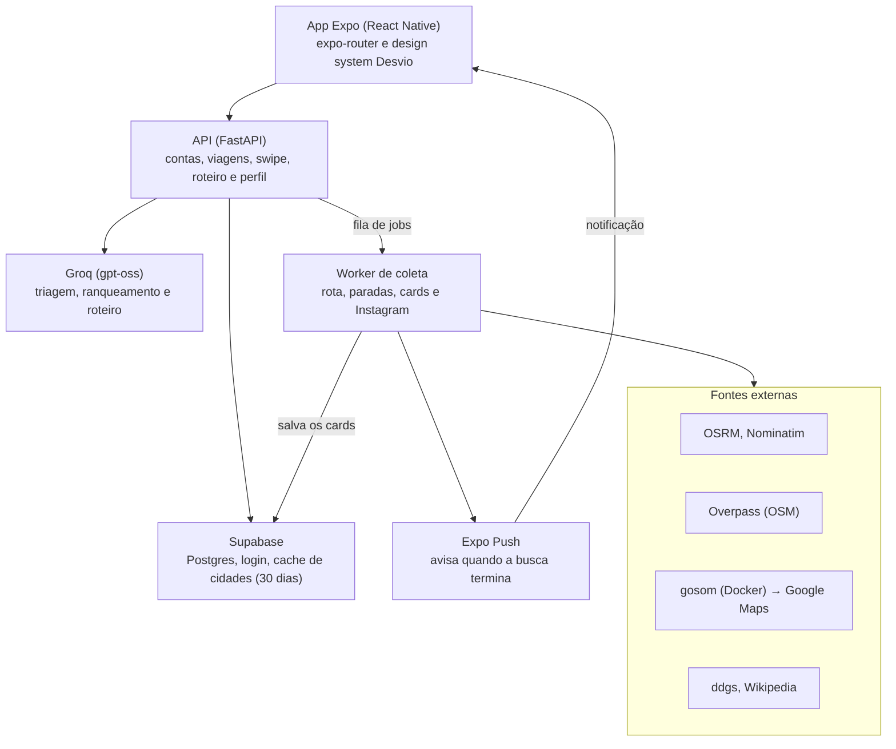

# Desvio — PRD

15/10/2026 · Leonardo

> Cópia do PRD. A versão viva, com comentários e prioridades editáveis, está no [documento do Claude](https://claude.ai/code/artifact/428f84a7-fe3b-45bd-9b53-8cdd0a07d016).

## Resumo e problema

O Desvio é um app de celular que monta viagens com paradas escolhidas por swipe: o app sugere lugares no caminho, a pessoa desliza Bora ou Passo, e a IA ordena o roteiro final.

Quem viaja de carro por milhares de quilômetros hoje planeja as paradas em várias abas (Google Maps, Instagram, blogs) e acaba parando no primeiro posto da estrada. Em viagens de avião com escalas, o problema é o mesmo: pouco tempo em cada cidade e muita pesquisa para decidir o que vale a pena.

O Desvio junta três coisas que hoje estão separadas:

- **Rota com paradas sugeridas.** Uma cidade a cada intervalo escolhido (padrão 200 km) e o destino, com atrações, restaurantes e postos de cada uma.
- **Decisão rápida.** Cards com foto, nota, km na rota e Instagram, decididos com um gesto.
- **Roteiro ordenado pela IA.** A ordem leva em conta o km, o horário (almoço, pôr do sol, pernoite) e o gosto aprendido nas decisões anteriores.

## Objetivos e métricas

O MVP tem sucesso se uma pessoa sai do app com um roteiro que ela realmente usa na estrada. As metas abaixo são hipóteses iniciais, para revisar depois do primeiro teste com usuários.

| Objetivo | Métrica | Meta inicial |
| --- | --- | --- |
| Montar uma viagem sem sair do app | Viagens criadas que chegam ao roteiro | 60% |
| Swipe que vale a pena | Taxa de Bora + Favorito sobre cards vistos | 35% a 50% |
| Ranqueamento que aprende | Taxa de aceite nos 20 primeiros cards de uma viagem, comparada à primeira viagem | +10 pontos |
| Roteiro usado de verdade | Roteiros abertos no mapa durante a viagem | 40% |
| Busca rápida o bastante | Tempo do toque em Buscar até o primeiro card | menos de 60 s com cache, até 4 min sem cache |
| Triagem leve | Triagens concluídas sem Pular | 70% |

## Público e personas

O público principal são brasileiros que fazem viagens longas de carro entre estados; viagens de avião com escala entram como segundo modo.

| Persona | Viagem típica | O que espera do app |
| --- | --- | --- |
| Casal na estrada | Alegrete, RS a Vitória da Conquista, BA, 2.731 km em 3 dias | Paradas para comer bem e ver mirantes sem desviar muito da rota |
| Família com crianças e pet | Viagem de férias de 800 a 1.500 km | Postos confiáveis, lugares com sombra e banheiro, nada longe da estrada |
| Viajante de avião | São Paulo a Salvador com 1 escala e 4 dias no destino | O que ver em cada cidade, dividido por dia e na ordem certa |

## Escopo do MVP

O MVP cobre a viagem de carro de ponta a ponta e o modo avião até o roteiro por dia; reservas, navegação curva a curva e social ficam de fora.

**Dentro**

- Login com Google, Apple e link de acesso por e-mail
- Triagem de preferências com IA, refeita pelo perfil
- Viagem de carro: origem, destino, intervalo entre paradas e categorias
- Viagem de avião: origem, escalas e dias por cidade
- Coleta de lugares (OpenStreetMap, Google Maps via raspador, Wikipedia) com Instagram dos restaurantes
- Swipe por parada com Bora, Passo, Favorito, desfazer e detalhe do lugar
- Roteiro ordenado pela IA, dividido por dia, com abertura no mapa
- Perfil com o gosto aprendido, intervalo padrão e tema claro, escuro ou do sistema

**Fora (por enquanto)**

- Reserva de hotel, passagem ou mesa
- Navegação curva a curva (o roteiro abre no app de mapas)
- Compartilhar viagem e planejar em grupo
- Uso offline durante a viagem
- Avaliações e fotos enviadas pelos usuários

## Fluxos e rotas

O fluxo principal tem 9 telas em linha: boas-vindas, entrar, triagem, viagens, nova viagem, carregando, paradas, swipe e roteiro. Perfil, escalas e detalhe do lugar saem dele. O mapa desenhado e as telas clicáveis, nos temas claro e escuro, estão no [canvas de rotas](https://claude.ai/artifact/Y8YekNeBFE8R8nxLUVuPXQ).

| Rota | Tela | Chega por | Leva a |
| --- | --- | --- | --- |
| /boas-vindas | Boas-vindas | Primeira abertura | /entrar |
| /entrar | Login | Boas-vindas | /triagem (primeiro login) ou /viagens |
| /triagem | Triagem com IA | Primeiro login, Perfil | /viagens/nova ou /perfil |
| /viagens | Minhas viagens | Aba Viagens | /viagens/nova, /viagens/:id/paradas |
| /viagens/nova | Nova viagem (carro ou avião) | Viagens, fim da triagem | /viagens/:id/carregando ou /viagens/nova/escalas |
| /viagens/nova/escalas | Escalas e dias | Nova viagem, modo avião | /viagens/:id/carregando |
| /viagens/:id/carregando | Carregando rota | Buscar | /viagens/:id/paradas |
| /viagens/:id/paradas | Paradas da viagem | Aba Descobrir | Swipe de uma parada, /viagens/:id/roteiro |
| /viagens/:id/paradas/:paradaId | Swipe | Toque numa parada | /lugares/:lugarId, volta às paradas |
| /lugares/:lugarId | Detalhe do lugar | Toque no card | Volta ao swipe |
| /viagens/:id/roteiro | Roteiro | Aba Roteiro, Montar roteiro | Mapa externo, /viagens/:id/paradas |
| /perfil | Perfil e gosto | Aba Perfil | /triagem |

A barra inferior (Viagens, Descobrir, Roteiro, Perfil) leva sempre à viagem ativa e some na criação de viagem, na triagem e no swipe.

## Histórias de usuário

São 19 histórias, 9 delas essenciais para o MVP; cada uma traz os critérios de aceite que fecham a entrega. A prioridade é editável na própria tabela.

| ID | Área | História | Critérios de aceite | Prioridade |
| --- | --- | --- | --- | --- |
| HU01 | Entrada | Como visitante, quero entrar com Google, Apple ou link por e-mail, para não precisar criar senha. | As três opções na mesma tela; o link expira em 15 min; o primeiro login leva a /triagem, os seguintes a /viagens. | Essencial |
| HU02 | Entrada | Como novo usuário, quero responder poucas perguntas em forma de conversa, para que as sugestões já venham no meu jeito de viajar. | No máximo 5 perguntas; respostas por chips (escolha única ou múltipla) e texto livre na última; a IA adapta a pergunta seguinte às respostas; Pular leva a /viagens e guarda o que já foi respondido; termina com um resumo do que a IA entendeu. | Essencial |
| HU03 | Entrada | Como usuário, quero refazer as perguntas pelo perfil, para corrigir o que a IA entendeu. | Link no perfil abre /triagem; as respostas novas substituem as antigas no perfil de gosto. | Desejável |
| HU04 | Planejar | Como motorista, quero informar origem, destino e de quantos em quantos km parar, para receber as cidades de parada no caminho. | Autocompletar de cidade com UF; intervalo de 150, 200 ou 300 km; cada parada mostra km e horas desde a saída; o destino entra sempre. | Essencial |
| HU05 | Planejar | Como motorista, quero escolher o que procurar (turismo, restaurante, posto, natureza, hospedagem), para não ver o que não me interessa. | Turismo, restaurante e posto vêm marcados; pelo menos uma categoria fica ligada. | Importante |
| HU06 | Planejar | Como viajante de avião, quero informar as escalas e os dias em cada cidade, para receber sugestões por cidade. | Até 5 cidades; dias de 1 a 5 ou mais; dá para reordenar e remover cidades. | Importante |
| HU07 | Planejar | Como usuário, quero acompanhar a busca e poder fechar o app, para não ficar preso esperando. | Etapas visíveis (rota, cidades, fotos e notas, Instagram); aviso push quando terminar; primeiro card em menos de 60 s quando a cidade já está em cache. | Essencial |
| HU08 | Decidir | Como usuário, quero ver as paradas na ordem da estrada com quantos lugares já escolhi em cada uma, para saber onde falta decidir. | Lista por km; contador "3 de 12" por parada; a parada atual fica destacada; toque abre o swipe dela. | Essencial |
| HU09 | Decidir | Como usuário, quero decidir cada lugar com um gesto ou um botão, para escolher rápido. | Direita = Bora, esquerda = Passo, para cima = Favorito; os três botões fazem o mesmo; carimbo aparece durante o arrasto; Desfazer por 4 s depois de Bora e Favorito. | Essencial |
| HU10 | Decidir | Como usuário, quero ver no card a foto, a nota com o número de avaliações, o km na rota e o Instagram, para decidir sem pesquisar fora. | Sem foto, o card mostra o céu com o ícone da categoria; nota e números no formato brasileiro; Instagram achado por busca aparece como "provável". | Essencial |
| HU11 | Decidir | Como usuário, quero abrir o detalhe do lugar, para ver endereço, horário e descrição antes de decidir. | Folha com endereço, horário de hoje, descrição, Instagram e link para o Google Maps; Bora e Passo também na folha. | Importante |
| HU12 | Decidir | Como usuário, quero filtrar o swipe por categoria, para focar no que preciso agora (por exemplo, só postos). | Chips de categoria no topo do swipe; o filtro vale só para aquela parada. | Desejável |
| HU13 | Roteiro | Como usuário, quero gerar o roteiro com os lugares que aceitei, para saber em que ordem parar. | Carro: ordem por km, ajustada pela IA ao horário (almoço, pôr do sol, pernoite); avião: dividido por dia com o menor percurso; cada item mostra km e hora estimada. | Essencial |
| HU14 | Roteiro | Como usuário, quero abrir o roteiro no app de mapas, para seguir as paradas na estrada. | Abre Google Maps ou Waze com as paradas como pontos de passagem; divide em trechos quando passa do limite de pontos do app. | Importante |
| HU15 | Roteiro | Como usuário, quero editar o roteiro, para tirar ou trocar lugares de ordem. | Remover e reordenar itens; botão Editar volta às paradas; o roteiro se refaz em segundos. | Importante |
| HU16 | Perfil | Como usuário, quero ver o que o app aprendeu do meu gosto, para entender as sugestões. | Taxa de aceite por categoria a partir de 20 swipes; número de lugares avaliados. | Desejável |
| HU17 | Perfil | Como usuário, quero escolher o tema claro, escuro ou do sistema. | Três opções; o padrão segue o sistema; a troca vale na hora. | Desejável |
| HU18 | Perfil | Como usuário, quero que lugares já avaliados não voltem e que os novos venham na ordem do meu gosto. | Card avaliado não reaparece em nenhuma viagem; os novos são ordenados pelo perfil de gosto. | Importante |
| HU19 | Perfil | Como usuário, quero apagar minha conta e meus dados, para sair quando quiser. | Exclusão no perfil com confirmação; dados apagados em até 15 dias, conforme a LGPD. | Essencial |

## IA: triagem, ranqueamento e roteiro

A IA trabalha em três momentos. Em todos ela recebe dados estruturados, e não texto solto, e devolve JSON validado pela API.

**1. Triagem (/triagem)**

- A primeira pergunta é fixa. As seguintes são geradas a partir das respostas, com no máximo 5 no total.
- Cada resposta vira um campo do perfil de gosto: categorias preferidas, com quem viaja, tipo de comida, orçamento e o que não pode faltar.
- Ao final, a IA escreve um resumo de uma frase. A pessoa vê esse resumo e pode corrigir no perfil.

**2. Ranqueamento dos cards**

- Primeiro passo, sem IA: a nota estatística do perfil (taxa de aceite por categoria, tipo e faixa de preço) mais a nota ajustada pelo número de avaliações. Isso já existe no coletor.
- Segundo passo, com IA: reordena os 30 primeiros cards de cada parada usando o resumo da triagem e as descrições dos lugares. Ex.: "viaja com pet" sobe lugares com área aberta.
- Cards já avaliados não voltam.

**3. Montagem do roteiro**

- Entrada: lugares aceitos com km, categoria, horário de funcionamento, hora de saída e dias.
- O algoritmo geométrico dá a ordem base: km na rota para carro; vizinho mais próximo com 2-opt e divisão por dia para avião.
- A IA ajusta a ordem ao horário (almoço entre 11h e 14h, mirante no fim da tarde, pernoite) e explica cada escolha numa linha.
- Se a IA falhar ou demorar mais de 10 s, o app mostra a ordem geométrica, sem travar.

## Dados e coleta

A base é o OpenStreetMap, gratuito e liberado para uso. O Google Maps entra como enriquecimento opcional, porque raspar o site viola os termos do Google.

| Fonte | Ferramenta | O que traz | Uso |
| --- | --- | --- | --- |
| OSRM | API pública ou servidor próprio | Rota, distância, duração | Sempre |
| Nominatim | API pública ou servidor próprio | Cidade em coordenada e vice-versa | Sempre, 1 requisição por segundo |
| Overpass (OpenStreetMap) | API pública | Cidades no caminho, postos, restaurantes, atrações | Sempre |
| Google Maps | [gosom/google-maps-scraper](https://github.com/gosom/google-maps-scraper) em Docker | Fotos, nota, avaliações, horários, faixa de preço | Opcional; todas as buscas de uma viagem num job só |
| Busca web | [ddgs](https://github.com/deedy5/ddgs) | Instagram de restaurantes sem site | Opcional, marcado como "provável" |
| Wikipedia | API REST | Foto e resumo de atrações | Quando o OSM aponta o artigo |

**Cache.** Os lugares de uma cidade ficam guardados por 30 dias e são reaproveitados entre usuários. É isso que leva o primeiro card a menos de 60 s.

**Modelo de dados (resumo)**

- usuario: id, e-mail, provedor de login, perfil de gosto (JSON da triagem), tema
- viagem: id, usuario, modo (carro ou avião), origem, destino, intervalo, categorias, status, polilinha da rota
- parada: viagem, ordem, cidade, UF, km, horas desde a saída ou dias
- lugar: id (gmaps:… ou osm:…), dados do card, fonte, coletado em
- decisao: usuario, lugar, viagem, parada, tipo (bora, passo, favorito), quando
- roteiro: viagem, itens ordenados com dia e hora estimada, explicação da IA

## Requisitos não funcionais

| Tema | Requisito |
| --- | --- |
| Desempenho | Swipe a 60 quadros por segundo em aparelho intermediário; próximo card pré-carregado; primeira tela em menos de 2 s |
| Busca | Primeiro card em menos de 60 s com cache; até 4 min sem cache, com aviso push ao terminar |
| Privacidade (LGPD) | Coleta mínima: e-mail, perfil de gosto e decisões; sem localização em segundo plano; exportar e apagar dados pelo perfil |
| Termos de uso | Raspagem do Google só em ambiente de teste. Para lançamento público, trocar pela Places API oficial (o código já isola essa fonte num módulo) |
| Servidores públicos | OSRM, Nominatim e Overpass são para uso leve; em produção, rodar instâncias próprias em Docker |
| Acessibilidade | Contraste AA nos dois temas (já verificado no design system); toda decisão de swipe também por botão; alvos de toque de 48 px ou mais; menos movimento respeitado |
| Visual | Design system [Desvio](https://claude.ai/artifact/4axmnGJWvKEXczHh3RP4uq): tokens, componentes e regras de uso |
| Idioma | Português do Brasil; números, datas e moeda no formato brasileiro |

## Arquitetura e stack

O app em Expo conversa só com a API; a coleta, que leva minutos, roda num worker separado e avisa o app por push quando termina.

| Camada | Escolha | Por quê |
| --- | --- | --- |
| App | Expo (React Native), expo-router, Reanimated e Gesture Handler | Swipe nativo e fluido; as rotas do canvas viram arquivos de rota |
| API e worker | Python e FastAPI | O coletor já existe nessa stack, com 8 testes |
| Banco e login | Supabase (Postgres e Auth) | Google, Apple e link por e-mail prontos; cache de cidades no mesmo banco |
| Raspagem do Google | gosom/google-maps-scraper em Docker | Projeto mais maduro do GitHub, licença MIT, API REST |
| IA | Groq, plano gratuito: `openai/gpt-oss-120b` (triagem e roteiro) e `openai/gpt-oss-20b` (ranqueamento), com structured outputs estritos | Gratuito e rápido; limite de 1.000 requisições e 200 mil tokens por dia por modelo (ver [verificação da stack](verificacao-stack.md)) |
| Fila de jobs | Tabela no Postgres do Supabase (`FOR UPDATE SKIP LOCKED`) | Sem Redis; a API cria o job e o worker consome |
| Avisos | Expo Push | Avisa quando a busca termina |
| Repositório | Monorepo [Lleooli/desvio](https://github.com/Lleooli/desvio) | apps/mobile, services/coletor, packages/design-tokens e docs |

## Riscos e questões em aberto

| Risco | Impacto | Plano |
| --- | --- | --- |
| Google bloqueia o raspador ou muda o HTML | Cards sem foto e sem nota | OpenStreetMap continua funcionando; trocar pela Places API antes do lançamento público |
| Busca demora (3 min ou mais por job) | Pessoa desiste antes do primeiro card | Cache por cidade; push quando terminar; começar a mostrar os cards do OSM enquanto o Google chega |
| Instagram errado (homônimos) | Perde confiança no card | Só mostrar o de busca como "provável"; preferir o link do site do lugar |
| Limite do Groq gratuito (8 mil tokens/min e 200 mil/dia por modelo) | De 7 a 14 viagens por dia | Ranqueamento estatístico primeiro; IA só nos 30 primeiros cards e no roteiro; cache das respostas; `reasoning_effort` baixo; plano Developer no beta |
| Poucas cidades no interior com dados | Paradas vazias | Aumentar o raio de busca; sugerir a próxima cidade maior |

**Em aberto**

- [ ] Nome definitivo do app (Desvio é provisório)
- [x] Qual LLM usar: Groq gratuito com gpt-oss (decidido em 2026-10-15). Falta definir quando passar para o plano Developer
- [ ] Modelo de receita: gratuito com limite de viagens, assinatura ou parcerias com restaurantes
- [ ] Hospedagem entra no swipe ou vira uma etapa separada da viagem

## Marcos e entregas

A Fase 0 está pronta; a próxima entrega é a viagem de carro funcionando de ponta a ponta. As datas ficam em aberto até definir quantas horas por semana vão para o projeto.

| Fase | Entrega | Libera a próxima quando |
| --- | --- | --- |
| 0 · Fundação (pronta) | Design system Desvio, mapa de rotas com telas claras e escuras, coletor FastAPI com testes, este PRD e o repositório | Repositório criado e coletor rodando com o gosom em Docker |
| 1 · Viagem de carro de ponta a ponta | Login, triagem com IA, nova viagem, swipe com desfazer, roteiro por km e abertura no mapa (histórias essenciais) | Uma viagem real planejada no app, do login ao roteiro aberto no mapa |
| 2 · Avião e IA no roteiro | Escalas e dias, roteiro por dia, ajuste de horário pela IA, perfil de gosto, filtros e edição do roteiro | O aceite sobe 10 pontos da primeira para a segunda viagem |
| 3 · Beta fechado | Places API no lugar do raspador, servidores próprios de OSM, aviso push, exportar e apagar dados (LGPD) e testes com usuários | — |

## Entregas da disciplina

O projeto é da disciplina Laboratório de Inteligência Artificial Aplicada e tem 8 entregas em grupo (Atividades 5 a 12) e uma individual (Atividade 13). As datas do calendário marcam a divisão do progresso; o prazo que vale é o da entrega final. Cada entrega fecha com a tag `atividade-NN` na `main` e um release que diz o que mudou desde a anterior, a base da apresentação de 5 minutos. As issues de cada entrega têm o label `ANN`.

A divisão é por área: Emilly (`lilydias24`) fica com todas as telas, o design system e o cliente da API no app; Leonardo (`Lleooli`) com o coletor e a IA; Guilherme (`GuiiVicent`) com infra, dados e qualidade. Issues que misturam tela e backend ficam com quem faz a maior parte delas.

| Atividade | Foco | Emilly | Leonardo | Guilherme |
| --- | --- | --- | --- | --- |
| 5 (tag pronta) | Fase 0 · Fundação | — | — | — |
| 6 (tag pronta) | IA no Groq com plano B, fila e worker assíncronos | — | — | — |
| 7 | Base: Supabase, autenticação e design system | #11, #12, #20 | #7, #34, #35 | #1, #2, #3 |
| 8 | API completa e app conectado | #14, #13 | #4, #5, #6 | #8, #9, #10 |
| 9 | Telas do fluxo da viagem | #15, #16, #17, #19 | #36, #41 | #38, #42 |
| 10 | Fechamento da Fase 1 | #18, #21, #22, #23 | #37 | #43, #24 |
| 11 | Fase 2: IA no roteiro, detalhe e perfil | #27, #31, #28 | #33 | #39 |
| 12 | Fim da Fase 2 e beta fechado | #29, #30, #32 | #40 | #44 |
| 13 | Site individual `liaa-<nome>.github.io` | #45 | #46 | #47 |

Dentro de cada entrega, nenhuma issue depende de outra pessoa na mesma entrega, salvo as de fechamento (#24 e #44), que ficam por último. As telas de avião (#25 e #26) saíram com a mudança de escopo para viagens só por terra (PR #52).
