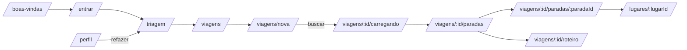

# Rotas do app

O mapa desenhado e as telas clicáveis (temas claro e escuro) estão no [canvas de rotas](https://claude.ai/artifact/Y8YekNeBFE8R8nxLUVuPXQ). Cada rota abaixo tem um arquivo em `apps/mobile/app/`.

| Rota | Tela | Arquivo | Histórias |
| --- | --- | --- | --- |
| /boas-vindas | Boas-vindas | `app/boas-vindas.tsx` | HU01 |
| /entrar | Login | `app/entrar.tsx` | HU01 |
| /triagem | Triagem com IA | `app/triagem.tsx` | HU02, HU03 |
| /viagens | Minhas viagens (aba) | `app/(abas)/viagens.tsx` | HU04, HU06 |
| /viagens/nova | Nova viagem | `app/viagens/nova/index.tsx` | HU04, HU05 |
| /viagens/:id/carregando | Carregando rota | `app/viagens/[id]/carregando.tsx` | HU07 |
| /viagens/:id/paradas | Paradas | `app/viagens/[id]/paradas/index.tsx` | HU08 |
| /viagens/:id/paradas/:paradaId | Swipe | `app/viagens/[id]/paradas/[paradaId].tsx` | HU09, HU10, HU12, HU18 |
| /lugares/:lugarId | Detalhe do lugar (modal) | `app/lugares/[lugarId].tsx` | HU11 |
| /viagens/:id/roteiro | Roteiro | `app/viagens/[id]/roteiro.tsx` | HU13, HU14, HU15 |
| /perfil | Perfil e gosto (aba) | `app/(abas)/perfil.tsx` | HU03, HU16, HU17, HU18, HU19 |

As abas **Descobrir** e **Roteiro** (`app/(abas)/descobrir.tsx` e `roteiro.tsx`) mostram as paradas e o roteiro da viagem ativa.

## Parâmetros

- `:id` — a viagem (`viagem_id` de `POST /viagem` no coletor; `GET /viagens` lista as da pessoa e `GET /viagens/{id}` traz paradas e cards)
- `:paradaId` — índice da parada na viagem (0 = primeira cidade; a última é o destino)
- `:lugarId` — id do card (`gmaps:…` ou `osm:…`)

## Fluxo

